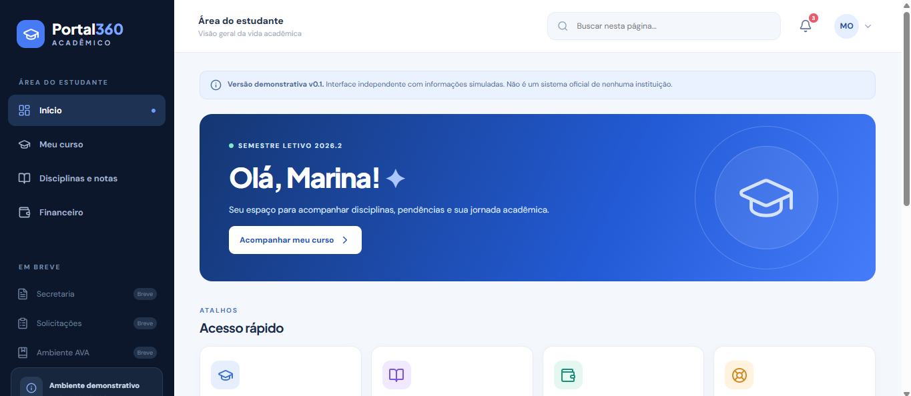

<div align="center">

# 🎓 Portal Acadêmico 360

**Uma experiência acadêmica digital, simples, moderna e centrada no estudante.**

[](./docs/ENTREGA-V0.md)


[Visão geral](#-visão-geral) · [Execução](#-executando-localmente) · [Arquitetura](#-arquitetura-atual) · [Inventário](#-inventário-e-evidências) · [Roadmap](#-roadmap)

</div>

---

## 🖥️ Visão do produto



<p align="center"><sub>Captura local da aplicação web v0.1, com dados fictícios. A imagem deve existir no repositório no caminho acima para aparecer no GitHub.</sub></p>

> [!IMPORTANT]
> **Projeto independente e não oficial.** O Portal Acadêmico 360 não possui vínculo, endosso nem integração autorizada com Anhanguera, UNIASSELVI ou outras instituições utilizadas como referência de funcionalidades. Não reproduz sistemas privados nem usa dados reais de estudantes.

### 💡 Visão geral

Construir um portal acadêmico responsivo que concentre, em uma navegação clara, acompanhamento do curso, disciplinas e notas, financeiro e, nas próximas versões, secretaria, solicitações e ambiente virtual de aprendizagem (AVA). O produto tem implementação própria e usa **dados simulados** na versão atual. A arquitetura futura prevê API compartilhada entre web e aplicativo móvel, sujeita à validação técnica e a autorizações institucionais para integrações reais.

## 📊 Estado do projeto

**Data-base:** 23/10/2026 · **Versão web:** `0.1.0` · **Branch:** `main` · **Marco de publicação:** [`39a66b9`](https://github.com/lucasrsantosdev/portal-academico-360/commit/39a66b9)

| Frente | Estado | Evidência / limite |
| :--- | :--- | :--- |
| Portal web (`apps/web`) | ✅ Executado localmente | React/Vite em `127.0.0.1:5173`, conforme capturas |
| Início / Dashboard | ✅ Demo navegável | Saudação, atalhos e tarefas simuladas |
| Meu curso | ✅ Demo navegável | Informações acadêmicas fictícias |
| Disciplinas e notas | ✅ Demo navegável | Listagem e filtros demonstrativos |
| Financeiro | ✅ Demo navegável | Mensalidades e serviços fictícios; sem pagamentos reais |
| Protótipo legado (`apps/portal-demo`) | ✅ Preservado | HTML, CSS e JavaScript |
| GitReverse (`tools/gitreverse`) | ✅ Executado separadamente | Correção SSE versionada; depende de serviços externos para análises |
| Secretaria, Solicitações e AVA | ⏳ Planejados | Ainda não implementados |
| API, banco e autenticação | ⏳ Planejados | Ainda não implementados |
| Build de produção e testes automatizados | 🔎 Não comprovados | Necessário registrar resultados |
| Aplicativo móvel | ⏳ Futuro | Android/iOS ainda não implementados |

> **Critério de evidência:** presença de arquivos e execução visual não equivalem a testes automatizados, segurança validada ou prontidão para produção.

## 🧭 Módulos e rastreabilidade

| Módulo | Documentação de levantamento | Estado |
| :--- | :--- | :--- |
| Dashboard | [`HOME-001`](docs/levantamento/HOME-001-dashboard.md) | Implementação demonstrativa |
| Meu curso | [`CUR-001`](docs/levantamento/CUR-001-meu-curso.md) | Implementação demonstrativa |
| Disciplinas e notas | [`DISC-001`](docs/levantamento/DISC-001-disciplinas.md) | Implementação demonstrativa |
| Financeiro | [`FIN-001`](docs/levantamento/FIN-001-financeiro.md) | Implementação demonstrativa |
| Secretaria | — | Backlog |
| Minhas solicitações | — | Backlog |
| AVA / Estudar | — | Backlog |

## 🏗️ Arquitetura atual

```text
portal-academico-360/
├── apps/
│   ├── web/                        # Produto principal: React 19 + Vite 6
│   │   ├── src/
│   │   │   ├── main.jsx            # Componentes e navegação
│   │   │   ├── data.js             # Dados fictícios
│   │   │   └── style.css           # Estilos da interface
│   │   ├── index.html
│   │   ├── package.json
│   │   ├── package-lock.json
│   │   └── vite.config.js
│   └── portal-demo/               # Protótipo estático anterior
├── docs/
│   ├── levantamento/              # HOME, CUR, DISC e FIN
│   ├── ENTREGA-V0.md
│   └── PLANO.md
├── imagem_portal/
│   └── imagem_portal_academico_360.png  # Evidência visual para este README
├── tools/
│   └── gitreverse/                # Ferramenta de terceiros, independente
├── .gitignore
├── publicar-github.ps1
└── README.md
```

A pasta `imagem_portal/` é o **caminho esperado da captura informado para esta atualização**; sua existência no GitHub depende de adicionar a imagem ao commit. `services/api`, `packages/` e `apps/mobile/` **não existem ainda** e não são representados como entregas atuais.

### Stack verificada no inventário

| Camada | Tecnologia | Papel |
| :--- | :--- | :--- |
| Interface web | React `^19.1.0`, React DOM `^19.1.0` | Componentes e navegação |
| Servidor/build web | Vite `^6.4.0` | Desenvolvimento e bundle |
| Ícones | `lucide-react` `^0.468.0` | Elementos visuais |
| Análise auxiliar | GitReverse, Next.js, TypeScript | Exploração técnica separada |
| Versionamento | Git + GitHub | Histórico e colaboração |

As versões da stack web acima são as **declaradas**, não necessariamente as versões resolvidas na instalação local.

## ▶️ Executando localmente

### Portal principal

Pré-requisitos: Node.js e npm reconhecidos pelo terminal.

```powershell
cd "C:\Users\User\Downloads\portal-academico-360-starter\apps\web"

# Se o terminal do VS Code ainda não reconhecer Node/npm:
$env:Path = "C:\Program Files\nodejs;$env:APPDATA\npm;$env:Path"

npm.cmd install
npm.cmd run dev
```

Acesse **http://127.0.0.1:5173/**. O Vite informa no terminal a porta efetivamente utilizada. Encerre com `Ctrl+C`.

**Build e prévia de produção (a validar e registrar):**

```powershell
npm.cmd run build
npm.cmd run preview
```

### Protótipo HTML anterior

```powershell
cd "C:\Users\User\Downloads\portal-academico-360-starter\apps\portal-demo"
npx.cmd --yes http-server . -p 8080
```

Acesse http://localhost:8080/.

### GitReverse (ferramenta separada)

```powershell
cd "C:\Users\User\Downloads\portal-academico-360-starter\tools\gitreverse"
pnpm.cmd install
# Criar .env.local a partir do exemplo apenas se ainda não existir:
if (-not (Test-Path .env.local)) { Copy-Item .env.example .env.local }
pnpm.cmd dev
```

Acesse http://localhost:3000/. Algumas análises requerem provedor de IA e `FIRECRAWL_API_KEY` ou `CONTEXT_DEV_API_KEY`; podem gerar custos e não fornecem acesso a conteúdos privados. Consulte [`README` do GitReverse](tools/gitreverse/README.md) e sua [`LICENSE`](tools/gitreverse/LICENSE).

## 🔍 Inventário e evidências

**Auditoria de referência:** 23/10/2026, 02:45:51 (horário registrado no inventário local).

| Indicador | Registro |
| :--- | :--- |
| Commit de referência | `39a66b9` |
| Branch | `main` |
| Arquivos versionados | **184** |
| Arquivos analisados pelo script | **186** (sem dependências e diretórios de build) |
| Arquivos do GitReverse versionados | **165** |
| Documentos funcionais | **4** |
| Arquivos `.env` reais rastreados | Nenhum detectado no inventário |
| Build/testes da web | Sem evidência conclusiva na auditoria |

No inventário constavam dois arquivos não rastreados: `package-lock.json` na raiz e `tools/gitreverse/pnpm-workspace.yaml`. Ambos exigem avaliação antes de inclusão ou descarte. A auditoria marcou Node/npm/pnpm como ausentes **na sessão examinada**, embora já tivessem executado em outras sessões: indicação de `PATH` inconsistente, não de instalação necessariamente ausente.

**Registro de marcos:**

| Commit | Entrega |
| :--- | :--- |
| `143f6bd` | Estrutura inicial e GitReverse |
| `2e67762` | Integração dos históricos |
| `6e12b2a` | README técnico inicial |
| `e4aed2a` | Levantamento dos módulos |
| `b13b17c` | Correção de fechamento duplicado do SSE |
| `39a66b9` | Portal web React v0.1 |

## 🛡️ Segurança e limites

- **Dados:** a v0.1 utiliza exemplos fictícios. Não há acesso a matrículas, dados financeiros reais ou sistemas institucionais.
- **Credenciais:** nunca versionar `.env.local`, tokens, cookies, senhas, códigos MFA ou chaves de API.
- **Propriedade intelectual:** referências servem à pesquisa funcional; a implementação e identidade visual do produto são próprias. Respeitar licenças, marcas e termos de terceiros.
- **Produção:** autenticação, controle de acesso, LGPD, testes de carga, logs, disponibilidade, backup e revisão de segurança ainda precisam ser projetados e validados.
- **Escala:** mais de 500 mil estudantes é uma hipótese de dimensionamento, **não uma capacidade comprovada**.

## 🗺️ Roadmap

| Marco | Escopo | Situação |
| :--- | :--- | :--- |
| **v0.1 — Fundação** | Portal React navegável, quatro módulos simulados e documentação inicial | ✅ Demonstração entregue |
| **v0.1.x — Qualidade** | Build verificado, testes, melhorias de acessibilidade, capturas e inventário versionado | 🔜 Próximo ciclo |
| **v0.2 — Serviços acadêmicos** | Secretaria, Solicitações e AVA demonstrativos | 📋 Planejado |
| **v0.3 — Plataforma** | Contratos de API, banco de dados e autenticação própria | 📋 Planejado |
| **v0.4 — Operação** | Testes automatizados, CI/CD, observabilidade e segurança | 📋 Planejado |
| **v1+ — Expansão** | Integrações autorizadas, dimensionamento e aplicativo móvel | 🎯 Visão futura |

## 📚 Documentação e governança

- [Escopo de entrega v0](docs/ENTREGA-V0.md)
- [Plano inicial](docs/PLANO.md)
- [Levantamento: Dashboard](docs/levantamento/HOME-001-dashboard.md)
- [Levantamento: Meu curso](docs/levantamento/CUR-001-meu-curso.md)
- [Levantamento: Disciplinas](docs/levantamento/DISC-001-disciplinas.md)
- [Levantamento: Financeiro](docs/levantamento/FIN-001-financeiro.md)
- [Repositório principal no GitHub](https://github.com/lucasrsantosdev/portal-academico-360)

**Padrão Observatório:** manter objetivos, entregas, evidências, limites e pendências claramente separados; atualizar README e inventário após cada marco validado; registrar commits pequenos e rastreáveis.

---

<div align="center">

**Portal Acadêmico 360 · v0.1 · 23/10/2026**

*Projeto independente, demonstrativo e em evolução.*

</div>

# GitReverse

https://github.com/user-attachments/assets/f0cdb7b2-c6f0-4483-8a01-153170479f2e

Turn a **public GitHub repository** into a **single synthetic user prompt** that someone might paste into Cursor, Claude Code, Codex, etc. to vibe code the project from scratch.

The app pulls **repo metadata**, a **root file tree** (depth 1), and the **README**, then uses an LLM to produce one short, conversational prompt grounded in that context.

Paste a GitHub URL or `owner/repo` on the home page. You can also open **`/owner/repo`** (e.g. `/vercel/next.js`) for a shareable link that runs the same flow.

GitHub-style **`/owner/repo/tree/...`** URLs on this site **redirect to `/owner/repo`** so they do not 404. The reverse flow still uses the whole repo for now; **subfolder-aware** context (scoped to that path) is planned for a later change.

## Stack

Next.js 16 (App Router), React 19, TypeScript, Tailwind CSS 4, GitHub API, Supabase (optional), Stripe (optional).

## Configuration

Copy `.env.example` to `.env.local` and fill in at least one LLM API key.

### Quick LLM (required)

The quick reverse endpoint supports five providers. Set **`GITREVERSE_QUICK_LLM`** to pin one, or leave it unset (`auto`) to let the app use whichever key it finds first:

| Provider | Key env var | Model env var | Default model |
|---|---|---|---|
| Grok (xAI) | `XAI_API_KEY` | `XAI_MODEL` | `grok-3` |
| OpenRouter | `OPENROUTER_API_KEY` | `OPENROUTER_MODEL` | `google/gemini-2.5-pro` |
| Azure OpenAI | `AZURE_OPENAI_API_KEY` + `AZURE_OPENAI_BASE_URL` | `AZURE_OPENAI_MODEL` | `gpt-5.4` |
| Google AI Studio | `GOOGLE_GENERATIVE_AI_API_KEY` | `GOOGLE_AI_STUDIO_MODEL` | `gemini-2.5-pro` |
| ApiSmart | `APISMART_API_KEY` | `APISMART_MODEL` | `DEEPSEEK_V4_FLASH` |

In `auto` mode the order of preference is: Grok → OpenRouter → Azure → Google → ApiSmart.

ApiSmart (sponsored) is an [OpenAI-compatible](https://docs.apismart.ai/api-guides/chat-completions-api) gateway. Copy the exact Model ID from the [ApiSmart models](https://www.apismart.ai/models) page (IDs differ from display names). Pin it with `GITREVERSE_QUICK_LLM=apismart`.

Azure quick reverse uses `gpt-5.4` by default with `AZURE_OPENAI_REASONING_EFFORT=medium`. Title generation also uses Azure and defaults to `gpt-5.4-mini` with reasoning disabled.

### Embeddings / library search

Prompt-cache embeddings and `/library` hybrid search now use Azure embeddings first:

- **`AZURE_OPENAI_EMBEDDING_MODEL`** — defaults to `text-embedding-3-small`
- **`AZURE_OPENAI_EMBEDDING_DIMENSIONS`** — defaults to `512`
- **`AZURE_OPENAI_EMBEDDING_DEPLOYMENT`** — optional explicit deployment name
- **`AZURE_OPENAI_DEPLOYMENT_NAME_MAP`** — optional `model=deployment` mapping when deployment names differ from model ids

If your Azure resource does not yet have an embedding deployment, you can temporarily set **`OPENAI_API_KEY`** as an embedding-only fallback while quick reverse and title generation stay on Azure.

### Other env vars

- **`GITHUB_TOKEN`** — optional; increases GitHub API rate limits.
- **`SUPABASE_URL`** + **`SUPABASE_PUBLISHABLE_KEY`** — optional; enables server-side caching of quick prompts in `prompt_cache` and exposes the `/library` page.
- **`VIEWS_IP_SALT`** — **required in production**. Generate one with `openssl rand -hex 32`. The app will refuse to start in production without a non-default value.

## Routes

| Path | Description |
|---|---|
| `/` | Home — quick reverse (codebase or website) |
| `/library` | Browse cached quick prompts (requires Supabase) |
| `/history` | Your prompt history (profile menu when signed in; syncs to Supabase) |
| `/[owner]/[repo]` | Shareable quick-reverse link |
| `/[owner]/[repo]/tree/...` | Redirects to `/[owner]/[repo]` |

## Development

```bash
pnpm install
pnpm dev
```

Open [http://localhost:3000](http://localhost:3000).

```bash
pnpm build
pnpm start
pnpm lint
pnpm test:library
```

`test:library` runs credential-free regression tests for library filtering, source fallbacks, and outage handling.

[Sponsor GitReverse](https://gitreverse.com/sponsor)

## License

GitReverse's source code is licensed under the [MIT License](LICENSE).

Third-party dependencies and assets retain their respective licenses and rights. See the [sponsor asset sources](public/sponsors/SOURCES.md) for the existing brand-asset notices.
